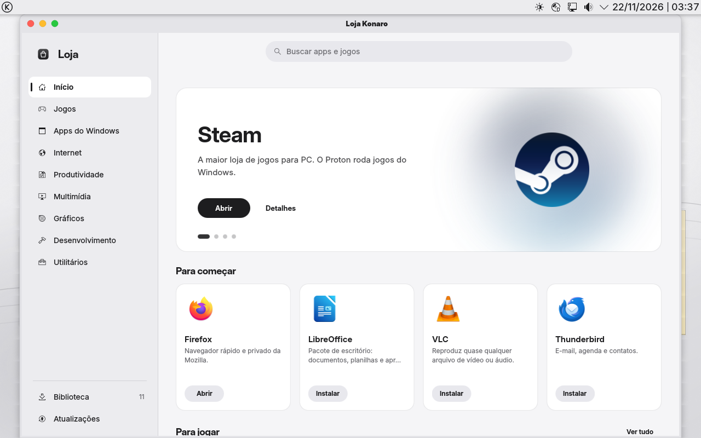
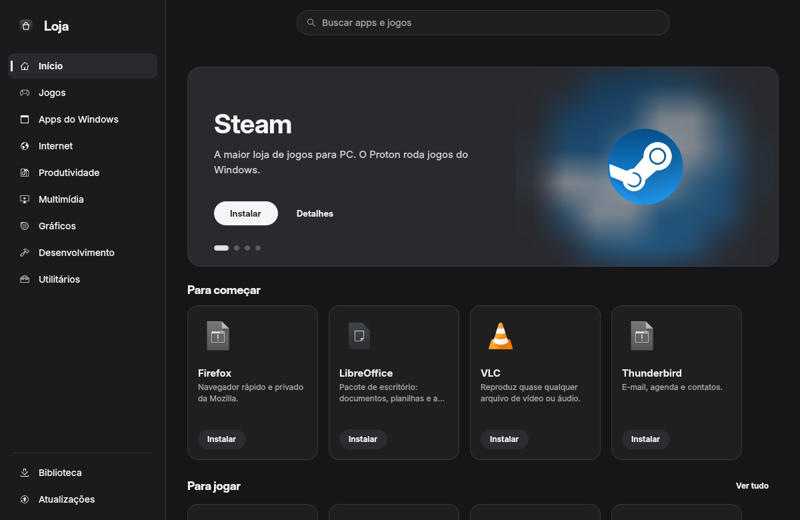
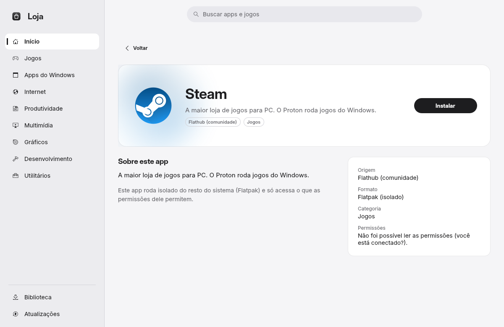
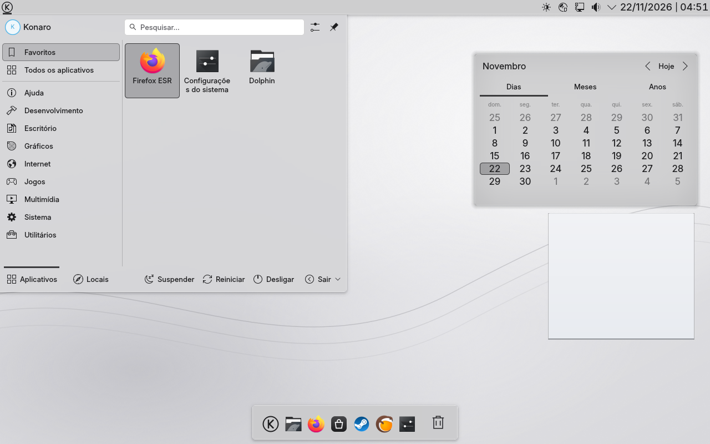
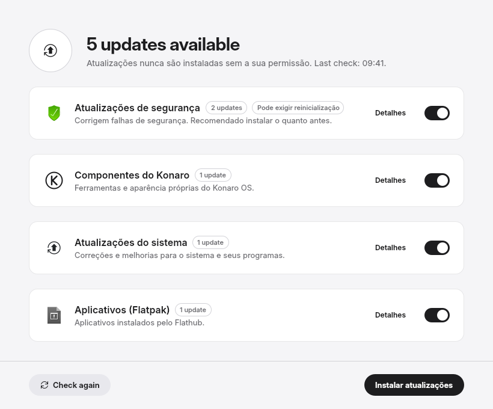
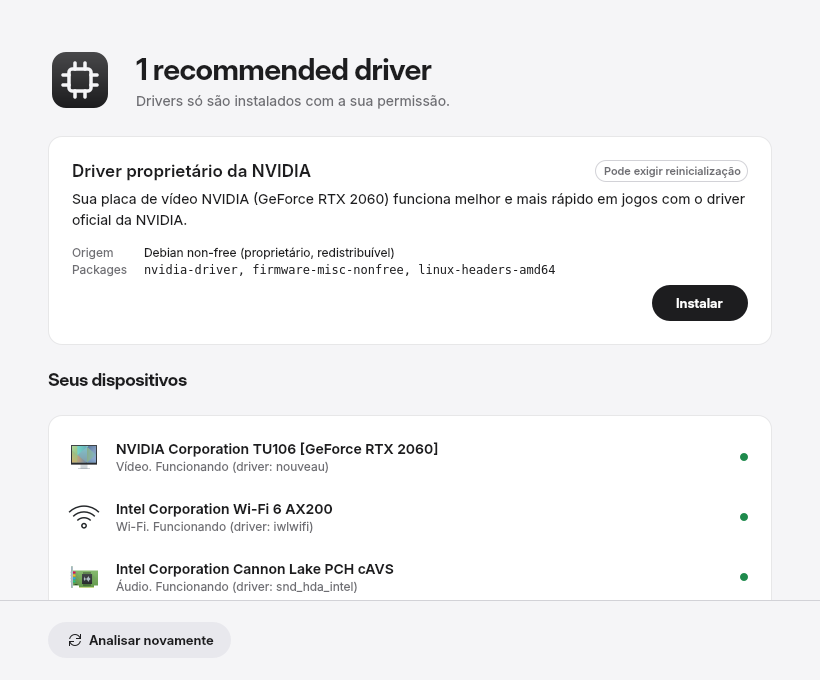
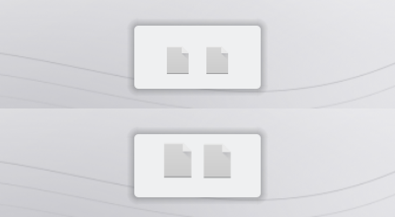

# Konaro OS

Distribuição Linux para desktop baseada em **Debian 13 "trixie"** e **KDE Plasma 6**,
com identidade própria, experiência inspirada no macOS e foco em quem nunca usou Linux.

> **Estado: build de desenvolvimento 0.1.0~dev1.** Ainda não é uma versão para uso diário.
> O que foi testado, e como, está em [docs/STATUS.md](docs/STATUS.md).

A referência central do projeto é o [documento mestre](docs/KONARO_OS_MASTER_SPEC.md).
Decisões técnicas ficam em [docs/decisions/](docs/decisions/), e o que ainda depende do
responsável pelo projeto em [docs/PENDING.md](docs/PENDING.md).

## O que o sistema traz

| Área | Implementação |
|---|---|
| Base | Debian 13, kernel do Debian, x86_64, ISO híbrida BIOS + UEFI (sem Secure Boot) |
| Desktop | KDE Plasma 6.3 (Wayland, com sessão X11), SDDM, Dolphin |
| Identidade | Temas **Konaro Claro/Escuro** (paleta neutra), papéis de parede, fonte Inter, tela "Olá… → Welcome to Konaro" — sistema de design em [docs/design/DESIGN.md](docs/design/DESIGN.md) |
| Área de trabalho | **Vidro só no que flutua** (barra superior, dock, menus, popups, widgets) com desfoque; janelas com botões **semáforo** à esquerda; **Dock Konaro** com ícones que sobem e crescem sob o ponteiro; **widgets nos cantos** (relógio, calendário, memória, notas), cada um pode ser ligado/desligado |
| Idiomas | Português (Brasil) e inglês — menu de boot com as duas opções |
| Instalador | Calamares (fluxo do Debian) com identidade Konaro e página **Navegadores** |
| Navegadores | **Firefox**, **Brave** e **Ungoogled Chromium** — o usuário escolhe quais manter na instalação |
| Loja Konaro | Visual de loja moderna (trilho lateral como a Microsoft Store, destaque, fileiras, página do app); 47 apps curados com ícones oficiais; origem, formato e permissões Flatpak; instala/remove via PackageKit e Flathub |
| Atualizações | Janela agrupada (segurança, sistema, Konaro, Flatpak) + aviso periódico; **nunca instala sem permissão** |
| Drivers | Detecta placa NVIDIA e outros dispositivos (`nvidia-detect`, `isenkram`), explica, pede permissão e instala |
| Boas-vindas | Assistente de primeiro uso: idioma, claro/escuro, internet, privacidade, atualizações, drivers, jogos, dicas |
| Jogos e Windows | Steam (Proton), Lutris, Wine 32+64 bits (duplo clique em `.exe`), GameMode, MangoHud, Vulkan; Bottles, Heroic, ProtonUp-Qt na Loja |
| Segurança | Firewall `ufw` ativo (bloqueia entrada) + módulo gráfico |
| Hardware | Firmware livre e `non-free-firmware` do Debian, microcódigo Intel/AMD |

**Ainda não existe** (por decisão do responsável): repositório APT próprio do Konaro,
Secure Boot, licença definida, assistente de IA. Próximos recursos sugeridos:
[docs/ROADMAP.md](docs/ROADMAP.md).

## Capturas de tela

| Loja (sessão real, botões semáforo) | Loja no escuro | Página do app |
|---|---|---|
|  |  |  |
| **Área de trabalho com widgets** | **Menu de vidro** | **Boas-vindas** |
|  |  |  |
| **Atualizações** | **Drivers** | **Dock: ícones sobem sob o ponteiro** |
|  |  |  |
| **Janela com botões semáforo** | | |
|  | | |

## Início rápido

```sh
./scripts/lint.sh                              # verificações estáticas + testes
sudo ./scripts/build-iso.sh                    # num Debian 13
# ou, em outro Linux:
sudo ./scripts/builder-chroot.sh setup && sudo ./scripts/builder-chroot.sh build-iso

./scripts/verify-iso.sh build/iso/konaro-os-*.iso     # confere a imagem
sudo ./scripts/test-system.sh                          # testa o sistema com systemd (sem VM)
./scripts/test-vm.sh --uefi build/iso/konaro-os-*.iso  # inicia numa VM QEMU
```

Detalhes: [docs/BUILDING.md](docs/BUILDING.md) e [docs/TESTING.md](docs/TESTING.md).

## Estrutura

```
live/                    configuração do Debian Live Build
  auto/config            opções do lb config (versão Debian, mirrors, boot, ISO)
  config/package-lists/  pacotes da imagem, agrupados e comentados
  config/hooks/normal/   i386, Flatpak, padrões, Calamares, verificações
  config/archives/       repositório do Brave (chave) e preferências do build
  config/bootloaders/    menu GRUB (PT/EN, tempo de espera, tema)
packages/
  konaro-desktop/        tema global, layout, splash, cores, papéis de parede, padrões (/etc/xdg)
  konaro-installer/      identidade do Calamares, página Navegadores, ajustes da sessão live
  konaro-tools/          Loja, Atualizações, Drivers, Boas-vindas, jogos (Python + Qt 6)
scripts/                 build, chroot de build, verificação da ISO, teste de sistema, VM, lint
docs/                    documento mestre, decisões, pendências, licenças, status
```

## Licença

**Pendente.** A licença dos componentes originais ainda não foi escolhida; veja
[docs/LICENSES.md](docs/LICENSES.md). Até lá, não publique ISOs ou pacotes.
