<p align="center">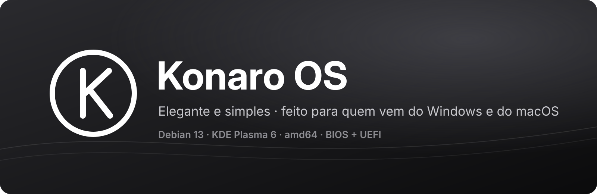</p>

<p align="center">
  <a href="https://gofile.io/d/mfNalg4T"></a>
  <a href="https://gofile.io/d/vGj27CVP"></a>
  <a href="CHANGELOG.md"></a>
  <a href="docs/STATUS.md"></a>
</p>
<p align="center">
  
  
  
  
  
  
</p>

<p align="center"><b>Um Linux bonito e fácil para quem nunca usou Linux.</b><br>
Visual inspirado no macOS, jeito de usar familiar para quem vem do Windows.</p>

<p align="center">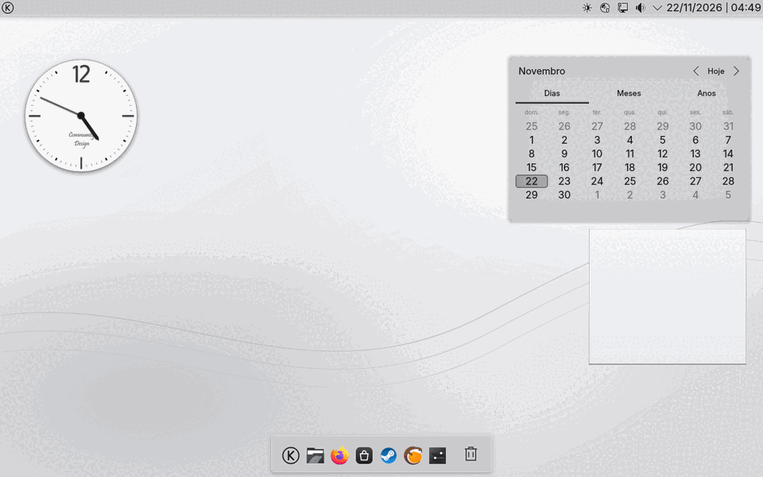</p>

---

## ⬇️ Download rápido

| Versão | Data | Tamanho | O que mudou | Baixar |
|---|---|---|---|---|
| 🔥 **0.1.0 "Fênix"** | 2026-11-23 | 2,4 GB | Primeira versão com nome. Tudo da build 9 (Liquid Glass, Loja com GitHub, .deb/AppImage, senha, firewall, sessões, temas) e o Wine fora da ISO | [**⬇ Baixar Fênix**](https://gofile.io/d/mfNalg4T) |
| 🔥 **0.1.0 "Fênix Lite"** | 2026-11-23 | 1,8 GB | Edição para **computadores antigos** (ex.: 2007, 3 GB de RAM): mesmo visual, memória comprimida, sem efeitos pesados, Firefox leve, funciona em placas de vídeo antigas | [**⬇ Baixar Fênix Lite**](https://gofile.io/d/vGj27CVP) |
| 0.1.0-dev9 · build 9 "Vidro" | 2026-11-23 | 2,6 GB | Liquid Glass com refração, Loja com apps do GitHub (Hydra Launcher), .deb e AppImage com dois cliques, senha nas Boas-vindas, firewall na Central de controle, GNOME/Xfce/Cinnamon/MATE e seletor de sessão, sistema identificado como Konaro OS, 12 cores de destaque e 5 temas de ícones | substituída pela Fênix |
| 0.1.0-dev8 · build 8 "Detalhes" | 2026-11-22 | 2,8 GB | Tela de bloqueio Konaro, fastfetch, animações, som de inicialização, "Por que está lento?", "Restaurar", .exe com Wine | substituída pela Fênix |
| 0.1.0-dev7 · build 7 "Avatares" | 2026-11-22 | 2,7 GB | Meu Avatar refeito | substituída pela build 8 |
| 0.1.0-dev6 · build 6 "Leve" | 2026-11-22 | 2,7 GB | Sistema mínimo, Voltar no tempo, repositório próprio, Central de controle, Spotlight, firmware, energia | substituída pela build 7 |
| 0.1.0-dev1 · build 5 "Mac + Windows" | 2026-11-22 | 4,1 GB | Login estilo macOS, Iniciar, widgets, fontes, Ajuda, Migração, Loja completa, Secure Boot | substituída pela build 6 |
| 0.1.0-dev1 · build 4 "Boot Konaro" | 2026-11-22 | 4,0 GB | Nova tela de carregamento com o logo Konaro | substituída pela build 5 |
| 0.1.0-dev1 · build 3 "Visual elegante" | 2026-11-22 | 4,0 GB | Vidro, botões semáforo, dock animado, widgets, nova Loja e instalador | substituída pela build 4 |
| 0.1.0-dev1 · build 2 "Ferramentas" | 2026-11-22 | — | Loja, Atualizações, Drivers, Boas-vindas, navegadores, jogos | substituída pela build 3 |
| 0.1.0-dev1 · build 1 "Fundação" | 2026-11-22 | — | Base Debian 13 + Plasma 6, instalador, identidade | substituída pela build 3 |

Site oficial: **[joaoplhrs.github.io/Konaro](https://joaoplhrs.github.io/Konaro/)** · Detalhes de cada versão em **[CHANGELOG.md](CHANGELOG.md)** · comparativo de desempenho com o Windows 11: **[docs/OTIMIZACAO.md](docs/OTIMIZACAO.md)**. SHA-256 — Fênix: `018b3422aa6af2c1a5a8ca4d36371b014f2fc73e1b0a2f0a901fb3585bc3e1bd` · Fênix Lite: `504b09255b95d5960e28d19b2aa5aa0b7024b05dc75f4e7ca0a06af2145e52ca`. Qual escolher? Veja **[docs/EDICOES.md](docs/EDICOES.md)**.

> ⚠️ **Build de desenvolvimento.** Teste primeiro numa máquina virtual. O que foi e o que
> não foi testado está em [docs/STATUS.md](docs/STATUS.md).

## ✨ Destaques

<table>
<tr>
<td width="50%">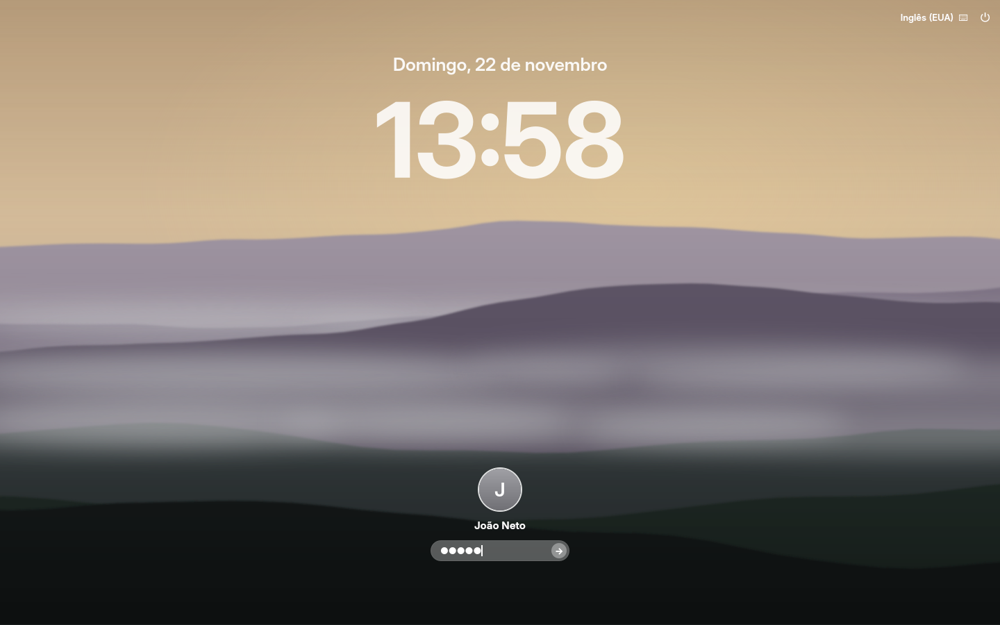<br><b>Tela de login</b> — data e hora grandes, foto e senha em pílula de vidro.</td>
<td width="50%">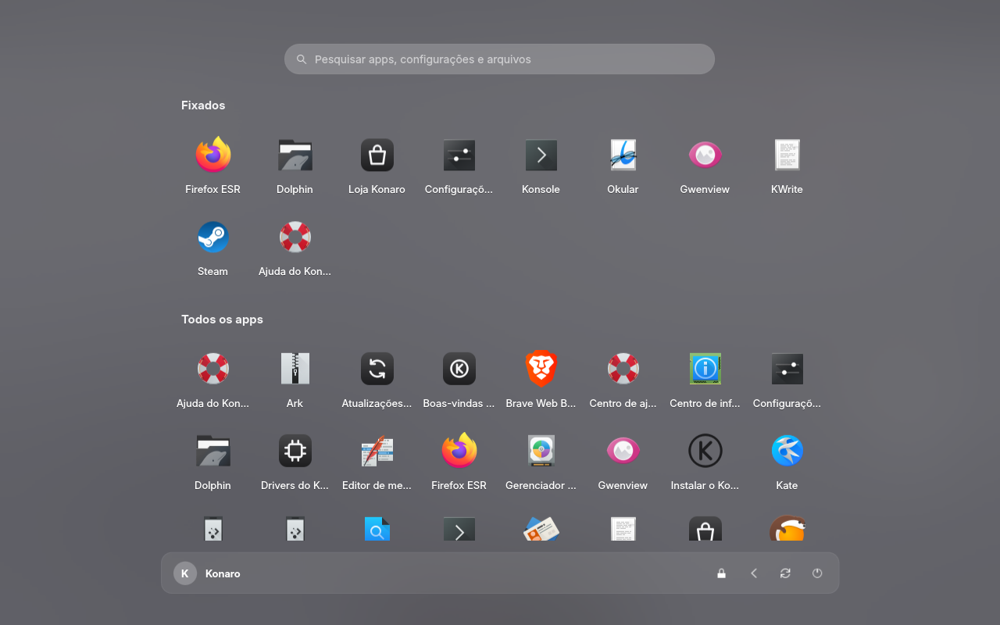<br><b>Iniciar (tecla Windows)</b> — busca, fixados e todos os apps em tela cheia.</td>
</tr>
<tr>
<td>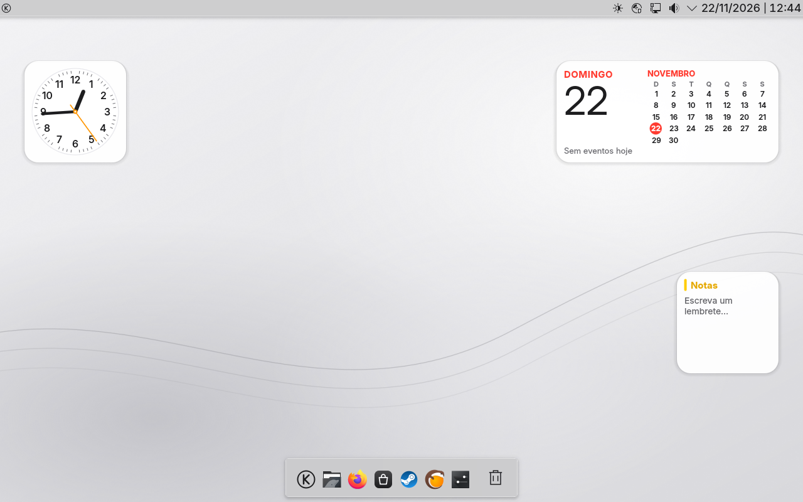<br><b>Widgets em cartões</b> — relógio, calendário, notas e sistema.</td>
<td>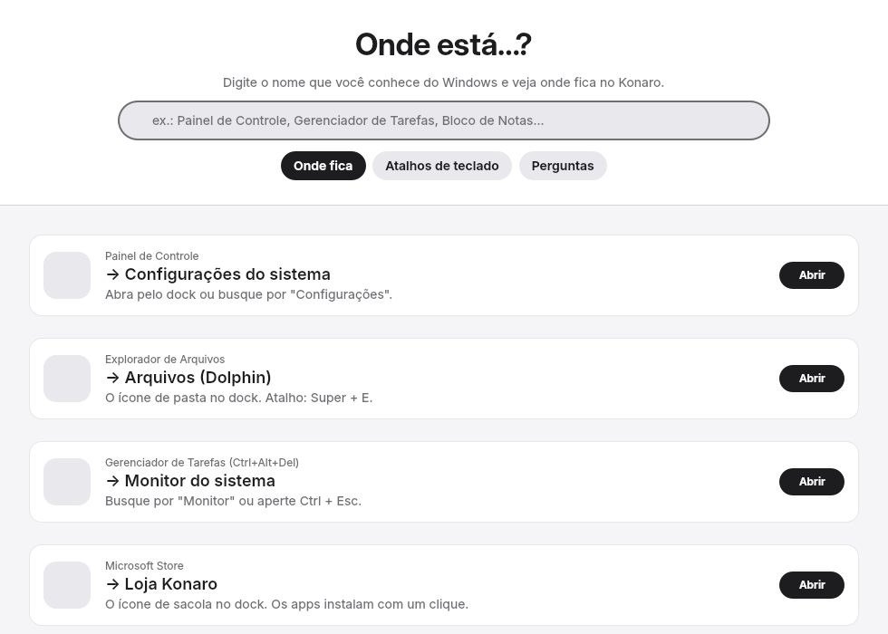<br><b>Ajuda "Onde está…?"</b> — o nome do Windows e onde fica no Konaro.</td>
</tr>
<tr>
<td>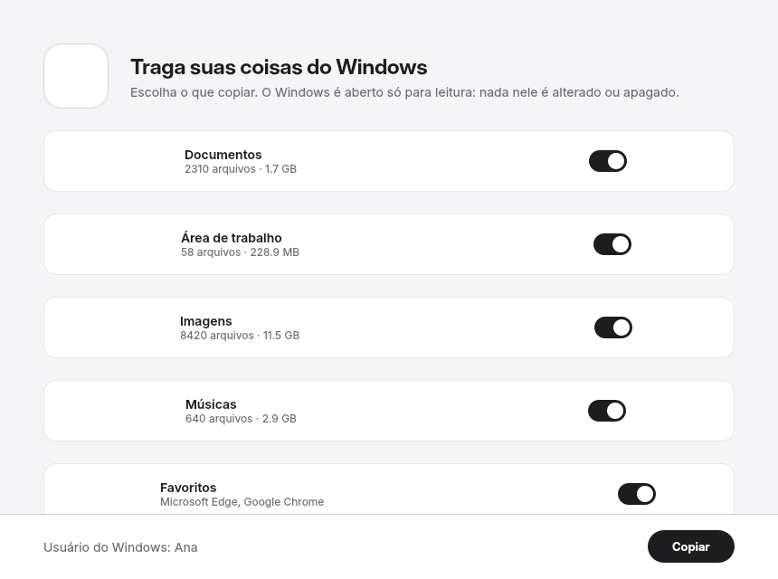<br><b>Migrar do Windows</b> — documentos, fotos, músicas e favoritos, sem alterar o Windows.</td>
<td>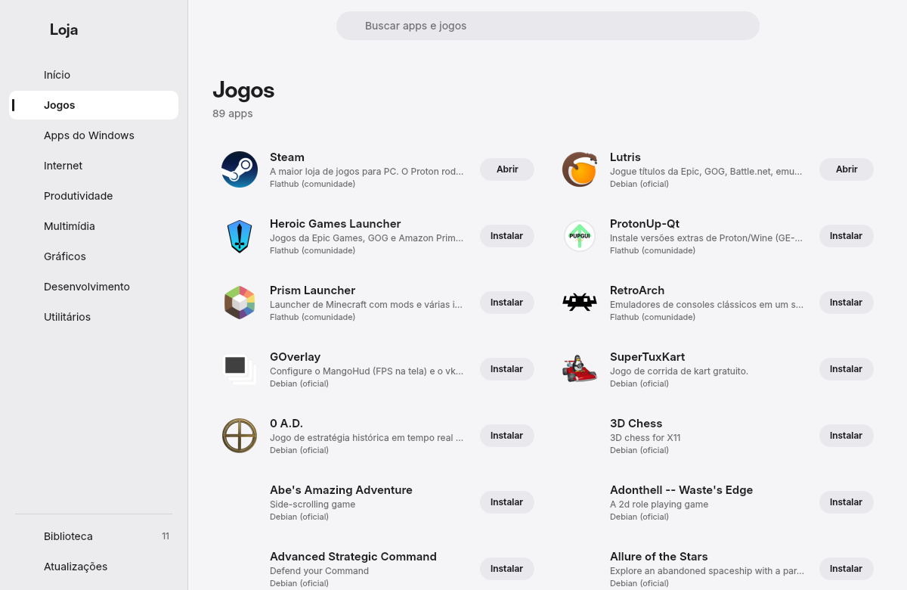<br><b>Loja com catálogo completo</b> — Debian + Flathub.</td>
</tr>
</table>

<table>
<tr>
<td width="50%">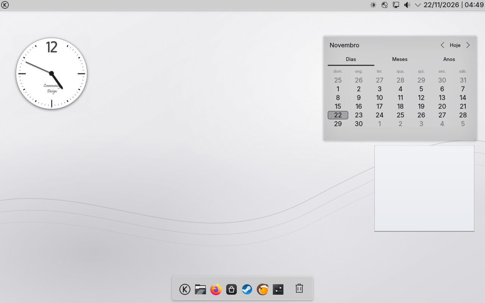<br><b>Área de trabalho</b> — widgets nos cantos, barra superior e dock de vidro.</td>
<td width="50%">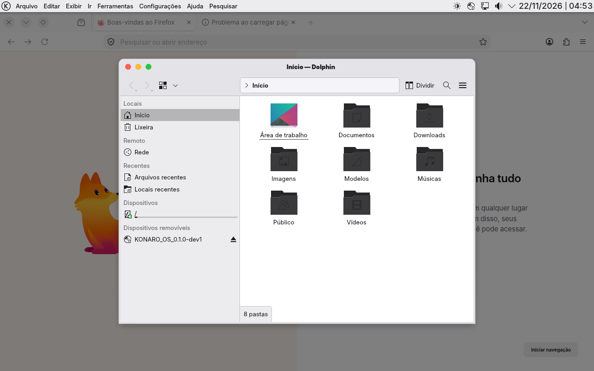<br><b>Janelas</b> — botões semáforo e menu global na barra superior.</td>
</tr>
<tr>
<td><br><b>Loja Konaro</b> — fácil como a Microsoft Store, com apps do Debian e do Flathub.</td>
<td><br><b>Boas-vindas</b> — 9 passos: idioma, tema, widgets, internet, privacidade, drivers e jogos.</td>
</tr>
<tr>
<td>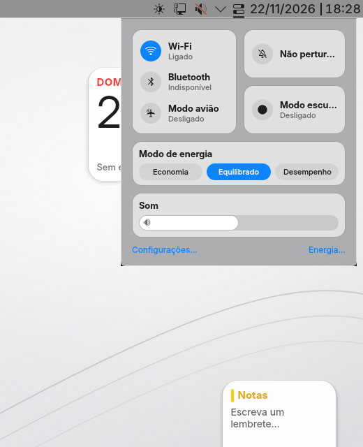<br><b>Central de controle</b> — Wi-Fi, Bluetooth, Não perturbe, modo escuro, energia, som e bateria.</td>
<td>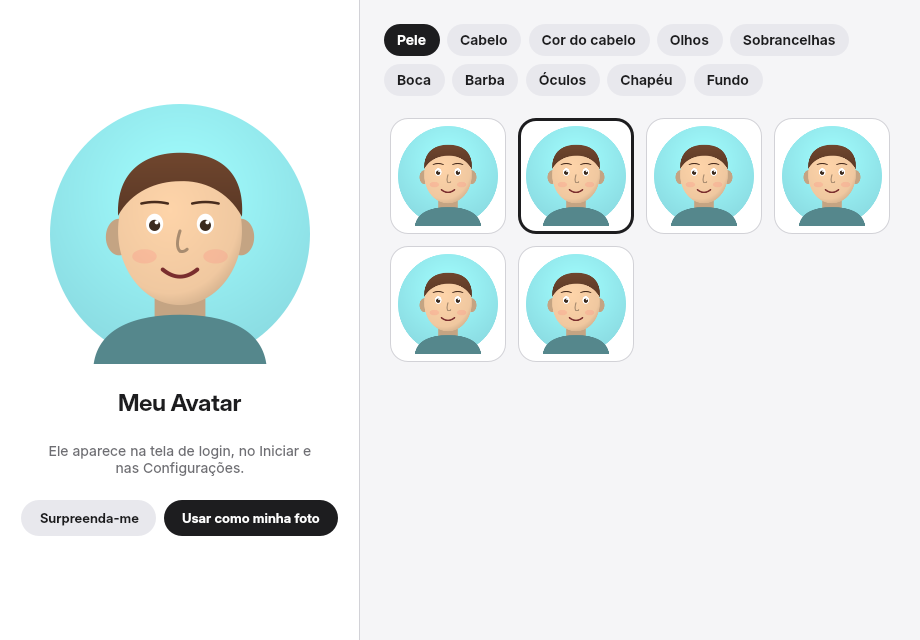<br><b>Meu Avatar</b> — personagens com volume; cores em amostras e cada parte em miniatura ampliada.</td>
</tr>
<tr>
<td colspan="2">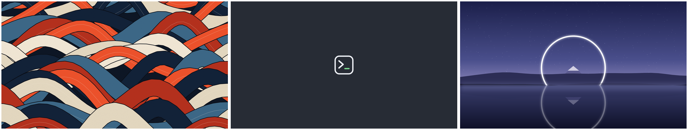<br><b>Papéis de parede novos</b> — Fluxo, Terminal e Anel.</td>
</tr>
</table>

<p align="center">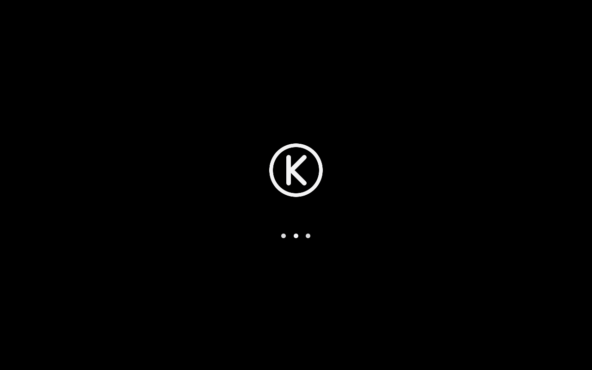<br><i>A nova tela de carregamento do sistema.</i></p>

<p align="center"><br><i>O dock: o ícone sob o ponteiro sobe e cresce.</i></p>

## 📦 O que vem no sistema

| Área | Implementação |
|---|---|
| Base | Debian 13, kernel do Debian, x86_64, ISO híbrida BIOS + UEFI (sem Secure Boot) |
| Desktop | KDE Plasma 6.3 (Wayland, com sessão X11), SDDM, Dolphin |
| Identidade | Temas **Konaro Claro/Escuro** (paleta neutra), papéis de parede, fonte Inter, tela "Olá… → Welcome to Konaro" — sistema de design em [docs/design/DESIGN.md](docs/design/DESIGN.md) |
| Área de trabalho | **Vidro só no que flutua** (barra superior, dock, menus, popups, widgets) com desfoque; janelas com botões **semáforo** à esquerda; **Dock Konaro** com ícones que sobem e crescem sob o ponteiro; **widgets nos cantos** (relógio, calendário, memória, notas), cada um pode ser ligado/desligado |
| Idiomas | Português (Brasil) e inglês — menu de boot com as duas opções |
| Instalador | Calamares (fluxo do Debian) com identidade Konaro e página **Navegadores** |
| Navegadores | **Firefox**, **Brave** e **Ungoogled Chromium** — o usuário escolhe quais manter na instalação |
| Loja Konaro | Visual de loja moderna (trilho lateral como a Microsoft Store, destaque, fileiras, página do app); 47 apps curados com ícones oficiais; origem, formato e permissões Flatpak; instala/remove via PackageKit e Flathub |
| Atualizações | Janela agrupada (segurança, sistema, Konaro, Flatpak) + aviso periódico; **nunca instala sem permissão** |
| Drivers | Detecta placa NVIDIA e outros dispositivos (`nvidia-detect`, `isenkram`), explica, pede permissão e instala |
| Boas-vindas | Assistente de primeiro uso: idioma, claro/escuro, internet, privacidade, atualizações, drivers, jogos, dicas |
| Jogos e Windows | Steam (Proton), Lutris, Wine 32+64 bits (duplo clique em `.exe`), GameMode, MangoHud, Vulkan; Bottles, Heroic, ProtonUp-Qt na Loja |
| Segurança | Firewall `ufw` ativo (bloqueia entrada) + módulo gráfico |
| Hardware | Firmware livre e `non-free-firmware` do Debian, microcódigo Intel/AMD |

## 🗺️ Próximos passos

Tudo da lista aprovada já está na build 5. Próximas ideias: "voltar no tempo" (snapshots),
repositório próprio, central de controle, impressoras sem configuração e mais.
Veja **[docs/ROADMAP.md](docs/ROADMAP.md)**.

## 🛠️ Para desenvolvedores

### Compilar e testar

```sh
./scripts/lint.sh                              # verificações estáticas + testes
sudo ./scripts/build-iso.sh                    # num Debian 13
# ou, em outro Linux:
sudo ./scripts/builder-chroot.sh setup && sudo ./scripts/builder-chroot.sh build-iso

./scripts/verify-iso.sh build/iso/konaro-os-*.iso     # confere a imagem
sudo ./scripts/test-system.sh                          # testa o sistema com systemd (sem VM)
./scripts/test-vm.sh --uefi build/iso/konaro-os-*.iso  # inicia numa VM QEMU
```

Detalhes: [docs/BUILDING.md](docs/BUILDING.md) e [docs/TESTING.md](docs/TESTING.md).

## Estrutura

```
live/                    configuração do Debian Live Build
  auto/config            opções do lb config (versão Debian, mirrors, boot, ISO)
  config/package-lists/  pacotes da imagem, agrupados e comentados
  config/hooks/normal/   i386, Flatpak, padrões, Calamares, verificações
  config/archives/       repositório do Brave (chave) e preferências do build
  config/bootloaders/    menu GRUB (PT/EN, tempo de espera, tema)
packages/
  konaro-desktop/        tema global, layout, splash, cores, papéis de parede, padrões (/etc/xdg)
  konaro-installer/      identidade do Calamares, página Navegadores, ajustes da sessão live
  konaro-tools/          Loja, Atualizações, Drivers, Boas-vindas, jogos (Python + Qt 6)
scripts/                 build, chroot de build, verificação da ISO, teste de sistema, VM, lint
docs/                    documento mestre, decisões, pendências, licenças, status
```

Documento mestre: [docs/KONARO_OS_MASTER_SPEC.md](docs/KONARO_OS_MASTER_SPEC.md) ·
decisões: [docs/decisions/](docs/decisions/) · pendências: [docs/PENDING.md](docs/PENDING.md) ·
design: [docs/design/DESIGN.md](docs/design/DESIGN.md).

## 🇧🇷 Créditos

Konaro OS — criado por **João Palhares**. Feito no Brasil.

Baseado no Debian e no KDE Plasma, com o trabalho de milhares de pessoas da comunidade de software livre.

## 📄 Licença

Ainda **não definida** para os componentes originais (veja [docs/LICENSES.md](docs/LICENSES.md)).
Os pacotes do Debian, do KDE e dos apps mantêm as próprias licenças.
